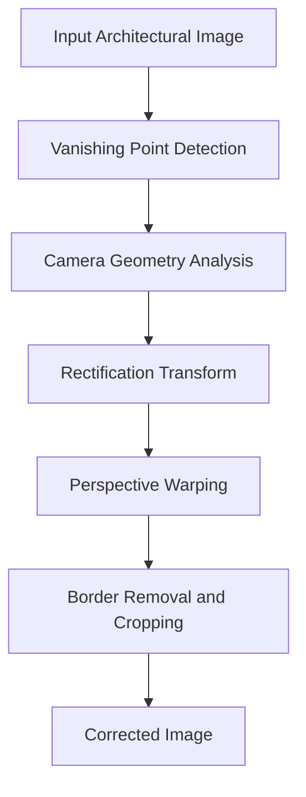

# Image Straightening for Real Estate Photography

A computer-vision tool designed to correct architectural perspective distortion in real-estate photographs. The system analyzes architectural lines, estimates vanishing points, and applies geometric transformations to produce straighter building structures.

## Features

- Vanishing-point detection
- Architectural perspective analysis
- Camera geometry estimation
- Perspective rectification
- Homography-based image transformation
- Black-border handling
- Automatic cropping
- Command-line image processing

## Workflow



## Project Structure

```text
Image_Straightening/
│
├── examples/
│   ├── raw/
│   │   └── Input Images
│   │
│   └── natural_corrected/
│       └── Reference Images
│
├── src/
│   ├── main.py
│   │
│   └── straightener/
│       ├── cropper.py
│       ├── detector.py
│       ├── geometry.py
│       └── rectifier.py
│
├── requirements.txt
├── README.md
└── .gitignore
```

## Technologies Used

- Python
- OpenCV
- NumPy
- Computer Vision
- Vanishing Point Detection
- Projective Geometry
- Homography Transformation

## Installation

### 1. Clone the repository

```bash
git clone git@github.com:prthickkcse2025-creator/Image_Straightening.git
cd Image_Straightening
```

### 2. Create a virtual environment

```bash
python -m venv .venv
```

Activate it:

**Linux / macOS**

```bash
source .venv/bin/activate
```

**Windows**

```bash
.venv\Scripts\activate
```

### 3. Install dependencies

```bash
pip install -r requirements.txt
```

## Usage

Run the straightening pipeline by specifying the input image and output destination.

```bash
python src/main.py --input "path/to/input.jpg" --output "path/to/output.jpg"
```

### Example

```bash
python src/main.py --input "examples/raw/0A5A2712.jpg" --output "output/corrected.jpg"
```

The output directory is created automatically when required.

## Sample Images

The repository contains sample architectural images for demonstrating the project structure and image-processing workflow.

- `examples/raw/` – Original input images
- `examples/natural_corrected/` – Reference naturally corrected images

The reference images are provided for visual comparison and are not necessarily outputs generated by this straightening pipeline.

## How It Works

1. **Image Input** – Loads the architectural photograph.
2. **Vanishing Point Detection** – Identifies perspective-related architectural directions.
3. **Geometry Analysis** – Analyzes the detected perspective and image geometry.
4. **Rectification** – Calculates a transformation to correct perspective distortion.
5. **Perspective Warping** – Applies the geometric transformation.
6. **Cropping** – Removes unwanted borders and adjusts the final image.
7. **Output** – Saves the corrected image.

## Applications

- Real-estate photography
- Architectural photography
- Interior photography
- Building documentation
- Perspective correction
- Architectural image preprocessing

## Limitations

Perspective correction depends on the quality of architectural line detection and vanishing-point estimation. Images with weak structural lines, complex geometry, severe distortion, or insufficient visible architectural features may produce less reliable results.

## Acknowledgements

This project utilizes vanishing-point detection techniques and related computer-vision concepts.

External dependency:

[XiaohuLuVPDetection](https://github.com/rayryeng/XiaohuLuVPDetection)

---

**Developed for architectural and real-estate image perspective correction.**
